<p align="center"></p>

<h3 align="center">Mezon: an AI auditor for local government decisions in Uzbekistan</h3>

<p align="center">


</p>

<p align="center">
<b><a href="#-presentations">Presentations</a></b> ·
<b><a href="#-the-problem">Problem</a></b> ·
<b><a href="#-the-product">Product</a></b> ·
<b><a href="#-results">Results</a></b> ·
<b><a href="#-how-the-model-was-built">Model</a></b> ·
<b><a href="#-data">Data</a></b> ·
<b><a href="#-run-it">Run it</a></b> ·
<b><a href="#-limits-and-ethics">Limits</a></b>
</p>

> **Mezon reads a hokim or Kengash decision, checks it against the law _as it read on the day the decision was signed_, and shows every possible defect with the article and a word-for-word quote.**
> It is the reviewer's first draft, not a verdict: a lawyer decides every flag.

| | |
|---|---|
| **Who uses it** | Adliya (Ministry of Justice) experts, hokimlik lawyers, advocates |
| **Live platform** | [e-mezon.uz](https://e-mezon.uz) (demo login on request) · source in [`platform/`](platform/) |
| **Our model** | Mezon-LM: Qwen3.8-27B + LoRA, trained on our own GPU (RTX PRO 6000, 96 GB) |
| **Hugging Face** | [model](https://huggingface.co/murodjontolipov/mezon-lm-small-v0.1) · [MezonBench v2.2](https://huggingface.co/datasets/murodjontolipov/mezonbench-v2.2) · [corpus](https://huggingface.co/datasets/murodjontolipov/mezon-corpus) |
| **Data stays in Uzbekistan** | the product never sends decision text to a cloud AI |

---

## 🎤 Presentations

| Deck | For | File |
|---|---|---|
| **Technical** (18 slides, English) | data, cleaning, LoRA, training ladder, live training, benchmark, results | [**PDF**](presentations/Mezon_Technical_Presentation.pdf) · [HTML](presentations/technical.html) |
| **Legal** | legal mentors: validity rules, real cases, 3333-format conclusion | [`presentations/legal.html`](presentations/legal.html) |
| **Business** (14 slides, Uzbek) | business mentors: problem, customer, model, cost, plan | [`presentations/business.html`](presentations/business.html) |
| Business appendix | extra slides: competitors, scale, phases | [`presentations/business-appendix.html`](presentations/business-appendix.html) |
| UI kit | the platform's design system (dashboard, AI chat, widgets) | [`docs/ui-kit/index.html`](docs/ui-kit/index.html) |

Download a deck and open it in a browser; use the arrow keys to move between slides.

---

## 📌 The problem

**Defective local decisions are cancelled months later, after people have already lost land, money or a business.** Courts cancelled or found unlawful **2,915** hokimlik decisions in 2023–2025 (1,371 · 933 · 611; Supreme Court figures via Daryo and Anhor). An adliya expert checks each draft **by hand in 2 to 5 working days** (Adliya order No. 3333).

<details open>
<summary><b>Real case 1: Yakkabog' cites an article that no longer existed</b></summary>

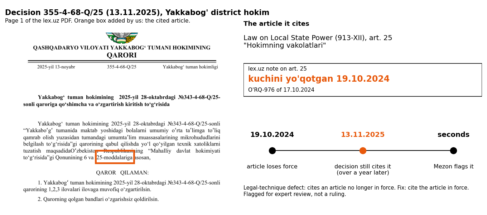

Decision **355-4-68-Q/25** (13.11.2025) relies on **article 25** of the Law on Local State Power. That article lost force on **19.10.2024** (O'RQ-976). Mezon found **68** decisions in **13 regions** citing dead articles.
</details>

<details>
<summary><b>Real case 2: Qarshi copied a decision word for word, then the state cancelled it</b></summary>

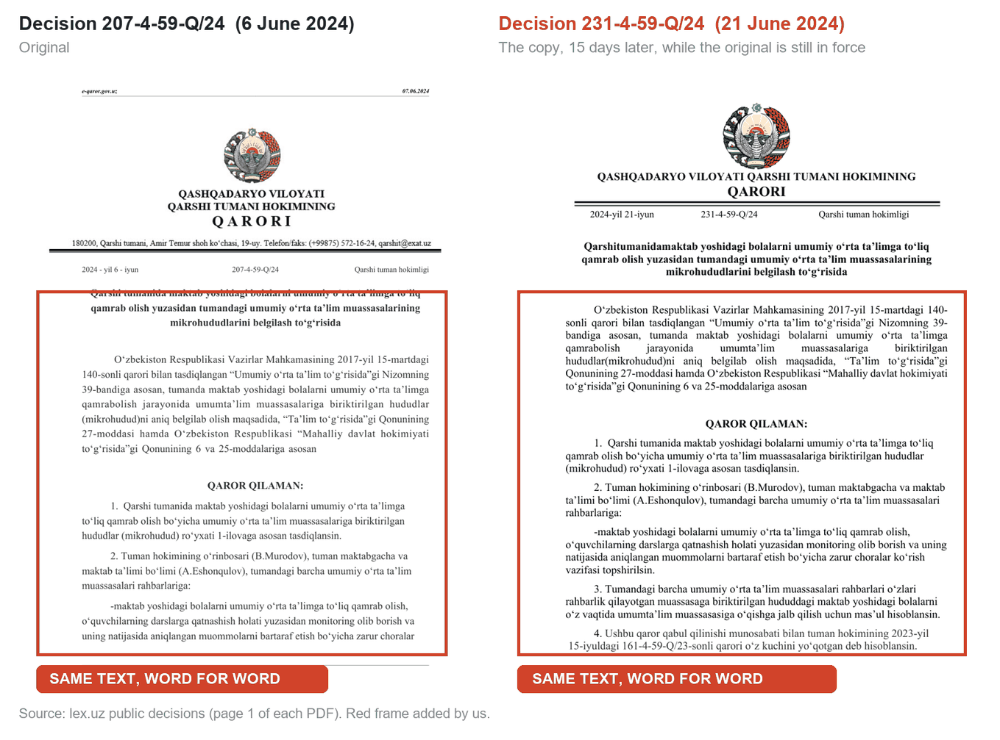

**231-4-59-Q/24** repeats **207-4-59-Q/24** word for word 15 days later, while 207 is still in force, and repeals **161-4-59-Q/23** a second time. It was cancelled by **261-4-59-Q/24** on the district adliya's representation No. 27-7/1-34. The platform now shows that basis on the decision page.

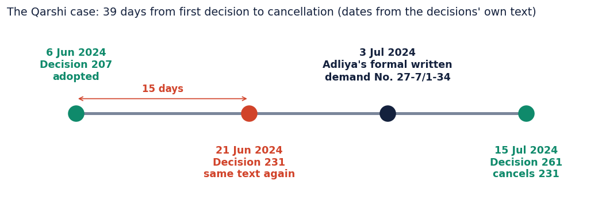
</details>

<details>
<summary><b>Scale: court cancellations by year</b></summary>

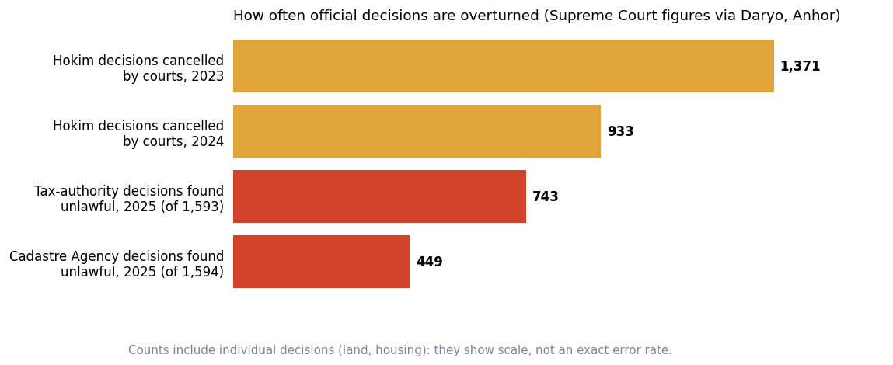
</details>

---

## 🖥 The product

Paste an E-qaror link, upload a PDF/DOCX, or open any of **446,859** real decisions. Mezon runs a live agent, step by step:

```
Qaror o'qildi (754 so'z)                         read the decision
Asos topildi: MDH Qonuni 6 va 25-moddalar        find its legal basis
6-modda 2025-11-13 holatida kuchda               check each article as of the decision date
25-modda 2024-10-19 dan kuchsiz                  ... and flag the dead one
Mezon qoidalari: 9 ta tekshiruv, 1 ta belgi      deterministic rule engine (no AI)
Mezon-LM xulosa yozmoqda…                        our model writes a 3333-format conclusion
```

**Home: real counts from 446,859 decisions**
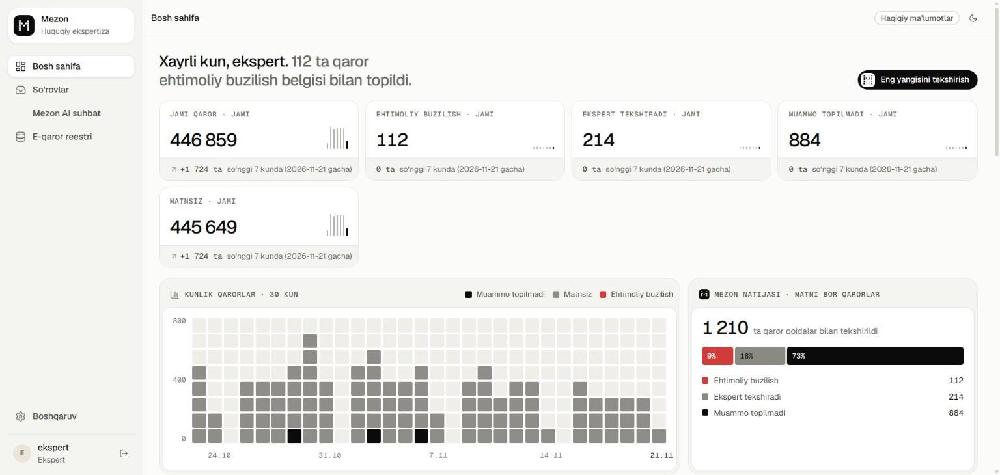

**So'rovlar: paste an E-qaror link, upload a PDF/DOCX or paste text; every row is a real decision**
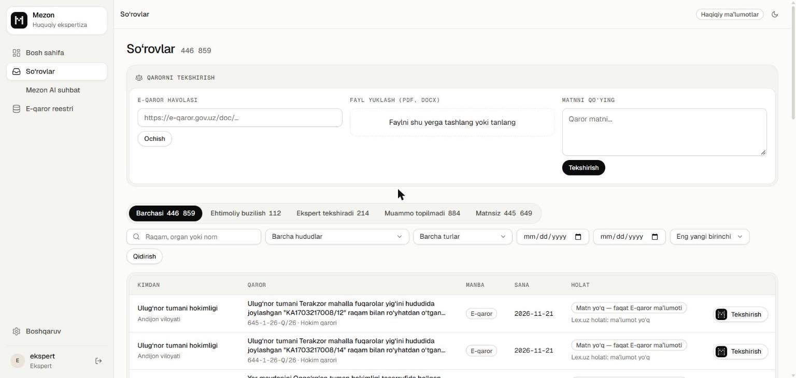

**A decision: law cards checked as of the decision date, flags with the article and a highlighted quote**
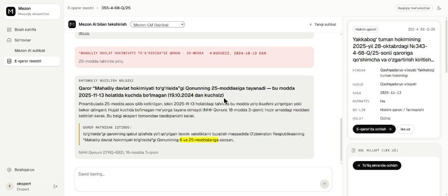

**What the expert sees, and where it comes from:**

| Block | Source |
|---|---|
| Law cards ("kuchda" / "kuchsiz, 2024-10-19 dan") | the law store: every edition of every act with its dates |
| Flags, red "ehtimoliy buzilish" or amber "ekspert tekshiradi" | deterministic rules, each with an article and a quote |
| Lex.uz status ("kuchini yo'qotgan, bekor qilgan …, asos: adliya taqdimnomasi") | the cancelling decision's own text |
| Conclusion (positive / positive with fixable defects / negative) | Mezon-LM on our GPU, with its tool calls shown |

Today: **112** high-confidence flags · **214** for expert review · **884** with no defect found · 445,649 E-qaror records whose text is still downloading.

<details>
<summary><b>The 14 checks</b></summary>

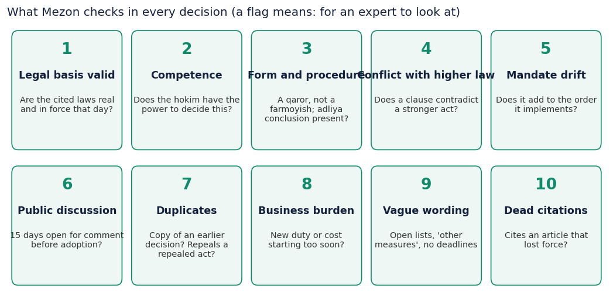
</details>

---

## 📊 Results

**1. From memory (closed book), the same 147 hard questions (MezonBench v2.2):**

| Model | Right | Wrong | "I don't know" |
|---|---:|---:|---:|
| Qwen3.8-27B (base) | 21 | 71 | 55 |
| **Mezon-LM** (law school + internship) | **39** | 56 | 52 |
| Claude Opus 5.5 | 28 | 29 | 90 |

Mezon-LM vs Opus on right answers: McNemar **z = 2.58** (p < 0.05). On **186 secret questions** never used in training: Mezon-LM **54** vs base **42** (z = 1.78, not yet significant).

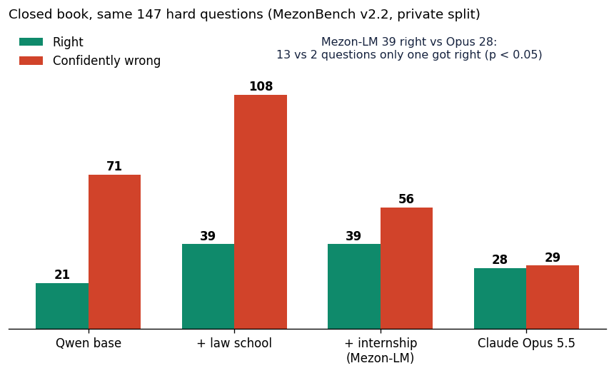

**2. With our law tools, 118 questions (MezonBench v1).** Here the model is the *base* Qwen (not Mezon-LM): this measures what our law tools add.

| Model | Alone | + Mezon law tools |
|---|---:|---:|
| Qwen3.8-27B (free, runs in Uzbekistan) | 44 | **116** |
| Claude Opus 5.5 | 56 | 115 |

The tools lift a free model to Opus level: the value is in the date-aware law store and verified citations.

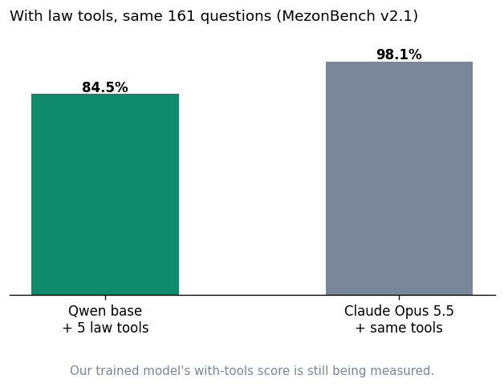

**3. Recall on real state cancellations** (first measurement, 21 Nov): of **259** E-qaror "declared invalid" decisions with text, Mezon flags **34 (13.1 %)**. Most are individual land/property decisions that procedure rules cannot catch; that is the next set of rules.

---

## 🧠 How the model was built

| Stage | What it learns | Method |
|---|---|---|
| 1. Law school | every law, every edition, with dates | continued pre-training (CPT) |
| 2. Internship | to use the law tools instead of guessing | supervised fine-tuning on tool sessions (ReAct) |
| 3. Strict judge | honesty: +1 right, 0 "I don't know", −1.5 confident and wrong | rejection-sampling FT / GRPO-style reward |
| 4. Real cases | the adliya conclusion format | cancelled decisions as the exam |

- **LoRA** (rank 128): the 27B base stays frozen; a small adapter is trained on one GPU.
- **Law school v2** (running now): 53,420 rows, **45.0M** trained tokens, 3,339 steps, ~870 tokens/s.

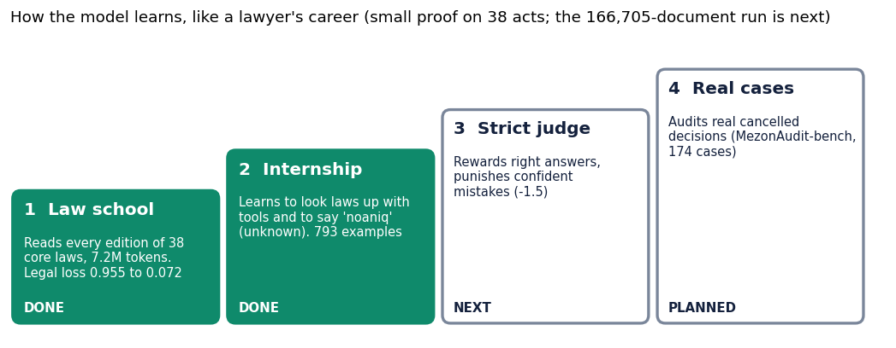

<details>
<summary><b>Stack</b></summary>

PyTorch · Hugging Face Transformers · PEFT (LoRA) · FastAPI (OpenAI-compatible API) · SQLite + FTS5 law store · bge-m3 embeddings · pdftotext · Tesseract OCR · Django · Cloudflare R2 · uv · pytest (234 tests)
</details>

---

## 🗂 Data

| Source | Count |
|---|---|
| lex.uz law documents | 166,705 |
| Scanned law PDFs read by OCR | 2,074 files, 43,333 pages |
| E-qaror local decisions (rows) | 446,859 in the platform; decision texts downloading |
| E-qaror-respublika (national acts) | 60,750 |
| public.sud.uz court case cards | 1.71 million |
| data.egov.uz legal datasets | 163 |

Only public, already-published documents are used. Citizens' names are never stored from court files and are masked before any training.

---

## ▶ Run it

```bash
uv sync
uv run pytest                                            # tests
.venv/Scripts/python.exe -X utf8 -m mezon.rules.run 231-4-59-Q/24   # audit one decision
.venv/Scripts/python.exe -X utf8 -m research.demo_check            # golden cases still pass
```

Architecture: [`docs/ARCHITECTURE.md`](docs/ARCHITECTURE.md) · model card: [`docs/MODEL_CARD.md`](docs/MODEL_CARD.md) · API for the platform: [`docs/API_for_platform.md`](docs/API_for_platform.md)

---

## ⚖ Limits and ethics

- **A flag is not a verdict.** Mezon never calls a decision illegal: "possible violation, for expert review". A human decides every flag (Adliya AI rules No. 3787).
- **No flag without a source:** every flag carries a lex.uz act, article and quote; otherwise the answer is "unclear, needs an expert".
- **Measured honestly:** recall on real cancellations is 13.1 % today; lawyer precision is still to be measured in the pilot.
- **Legality, not corruption:** no rankings of officials, no accusations.

<p align="center"><sub>Mezon · LexHackathon 2026 · Murodjon Tolipov</sub></p>
