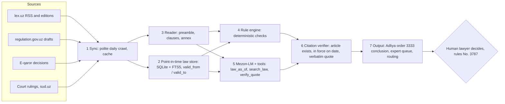

# Mezon architecture (one page)

## The 7 layers

1. **Sync.** lex.uz RSS and edition pages, regulation.gov.uz and regulation.adliya.uz drafts, the E-qaror list API, court rulings. Every response is cached; spacing and back-off keep it polite.
2. **Point-in-time law store.** Every edition of every act split by article, part and clause, each with `valid_from` and `valid_to`; typed edges (amends, repeals, cites). "Article N as on date D" returns the edition in force that day.
3. **Reader.** Parses a decision into preamble (legal basis), numbered clauses and annex (`research/textnorm.py`).
4. **Rule engine.** Deterministic, zero-hallucination checks: qaror not farmoyish, public discussion window, 3-month business rule, duplicate clauses, repeal errors, cited act in force. Each returns a flag with evidence.
5. **Mezon-LM with tools.** Open questions only (conflict with a higher norm, mandate drift). The model must call the tools and return a verdict with quotes, or "unclear".
6. **Citation verifier.** Drops any claim whose act or article does not exist, was not in force on the decision date, or whose quote is not verbatim.
7. **Output and routing.** Adliya's format (positive, positive with fixable defects, negative; defect to article to quote), a ranked expert queue, a plain explanation for the affected person, one-tap routing to existing channels. A human decides each flag.

Training pipeline for layer 5: law school (continued pre-training), then internship (SFT on tool-use traces), then strict judge (expert iteration, reward +1 / +0.2 / -0.25 / -1.5). Scored on MezonBench v1.1, v2.1, v3 and MezonAudit-bench.
